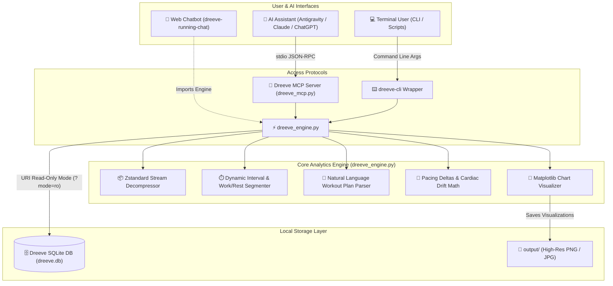

# Dreeve Running Analytics & MCP Server 🏃‍♂️📊

[](https://www.python.org/downloads/)
[](https://modelcontextprotocol.io/)
[](https://opensource.org/licenses/MIT)

A high-performance, token-efficient analytics engine and [Model Context Protocol (MCP)](https://modelcontextprotocol.io/) server built for self-hosted [Dreeve](https://github.com/robiningelbrecht/dreeve) fitness databases.

Computes sub-second kilometer splits, decompressing high-frequency Zstandard sensor streams, analyzes arbitrary and variable interval workouts (with natural language plan parsing or auto-detection), tracks cardiac drift, and empowers AI pair-programming agents (such as Google Antigravity, Claude, and ChatGPT) with instant, direct access to running metrics without burning tokens on raw SQL dumps.

> [!TIP]
> **Looking for the interactive Web Chatbot?** Check out the companion repository: **[dreeve-running-chat](../dreeve-running-chat)** for the containerized Streamlit running coach interface.

---

## 🏛️ System Architecture



---

## ✨ Key Capabilities

* **Token-Optimized Aggregation:** Queries return compact, pre-summarized JSON payloads (~150–250 tokens), preventing context window exhaustion in AI assistants.
* **Arbitrary & Variable Interval Analysis:**
  * Accepts natural language workout plans: e.g. `1k warmup + 4x1K @6:15 with 90s walk + 0.5k cooldown` or `0.8k easy, 2x1.5k @ 6:00, 1k @ 7:00`.
  * Computes work interval pacing, target pace deltas, peak HR, and heart rate recovery drop during rest breaks.
  * Robust fallback **auto-detection** for unstructured or freeform interval runs.
* **Sub-Second Stream Decompression:** Built-in Zstandard decompression decodes sub-second GPS, cadence, heart rate, and elevation telemetry from the Dreeve `ActivityStream` store.
* **Kilometer Splits & Cardiac Drift Tracking:** Aggregates splits across weeks or months to quantify cardiovascular decoupling and aerobic endurance progression.
* **Native Model Context Protocol (MCP):** Connects directly to AI coding and research agents (Antigravity, Claude Desktop, Cursor).
* **Zero Database Contention:** Connects via URI read-only mode (`?mode=ro`) with SQLite Write-Ahead Logging (WAL) support, guaranteeing zero locks on the running Dreeve instance.

---

## 📁 Repository Structure

```text
dreeve-analytics/
├── dreeve_engine.py           # Core analytics, interval parsing, stream decompression & plotting
├── dreeve_mcp.py              # Model Context Protocol (MCP) server
├── dreeve-cli                 # Executable CLI wrapper
├── requirements.txt           # Python package requirements
├── config/
│   └── mcp_config.example.json # Example MCP configuration for AI agents
├── skill/
│   └── SKILL.md               # Antigravity Agent Skill instructions
├── LEARN.md                   # Architecture & mental models guide
└── output/                    # Persistent directory for generated plots & reports
```

---

## 🚀 Getting Started

### 1. Installation
```bash
git clone https://github.com/JournalKenobi/dreeve-analytics.git
cd dreeve-analytics
pip install -r requirements.txt
```

### 2. Configuration
Copy the environment template and specify the path to your Dreeve SQLite database:
```bash
cp .env.example .env
# Edit .env to set your DREEVE_DB_PATH (default: ../dreeve/storage/database/dreeve.db)
```

---

### 3. Standalone CLI Usage (`dreeve-cli`)

A convenience wrapper is provided at `./dreeve-cli` (or symlink to `~/.local/bin/dreeve-cli`):

#### Variable Interval Workout Analysis
```bash
# Analyze with a structured plan
./dreeve-cli intervals --plan "1k warmup + 4x1k @6:15 with 90s walk + 0.5k cooldown"

# Analyze with variable distances
./dreeve-cli intervals --plan "0.8k easy, 2x1.5k @ 6:00, 1k @ 7:00"

# Auto-detect intervals without a plan
./dreeve-cli intervals --activity <activity_id>
```

#### High-Level Performance Summary
```bash
./dreeve-cli summary --days 60
```

#### Kilometer Splits & Cardiac Drift
```bash
./dreeve-cli splits --month 2026-10 --summary-only
```

#### Generate Performance Charts
```bash
# Pace vs. Heart Rate Scatter
./dreeve-cli plot --type pace_vs_hr --days 60 --theme dark

# Longitudinal Performance Dashboard
./dreeve-cli plot --type dashboard --days 60 --theme dark
```

---

### 4. MCP Server Integration (for AI Assistants)

Add `dreeve` to your agent's MCP configuration (`mcp_config.json`):

```json
{
  "mcpServers": {
    "dreeve": {
      "command": "python",
      "args": ["/path/to/dreeve-analytics/dreeve_mcp.py"],
      "env": {
        "PYTHONPATH": "/path/to/dreeve-analytics",
        "DREEVE_DB_PATH": "/path/to/dreeve/storage/database/dreeve.db",
        "DREEVE_OUTPUT_DIR": "/path/to/dreeve-analytics/output"
      }
    }
  }
}
```

#### Exposed MCP Tools

| Tool | Parameters | Description |
| :--- | :--- | :--- |
| `dreeve_intervals` | `activity_id`, `plan`, `generate_plot` | Analyzes variable structured interval runs or auto-detects work/rest reps with HR recovery drops. |
| `dreeve_summary` | `days`, `sport` | Statistical summary, HR zones, and pacing correlation in ~150 tokens. |
| `dreeve_splits` | `activity_id`, `days`, `month`, `summary_only` | Sub-second kilometer splits, pacing, mean HR, and cardiac drift progression. |
| `dreeve_activities` | `days`, `limit`, `with_hr_only`, `search` | Filtered list of recent workout activities. |
| `dreeve_plot` | `chart_type`, `days`, `theme` | Renders high-resolution fitness plots directly into `output/`. |
| `dreeve_query` | `sql` | Safe, read-only SQL query execution with automatic row/token guardrails. |

---

## 📄 License

This project is licensed under the [MIT License](LICENSE).
