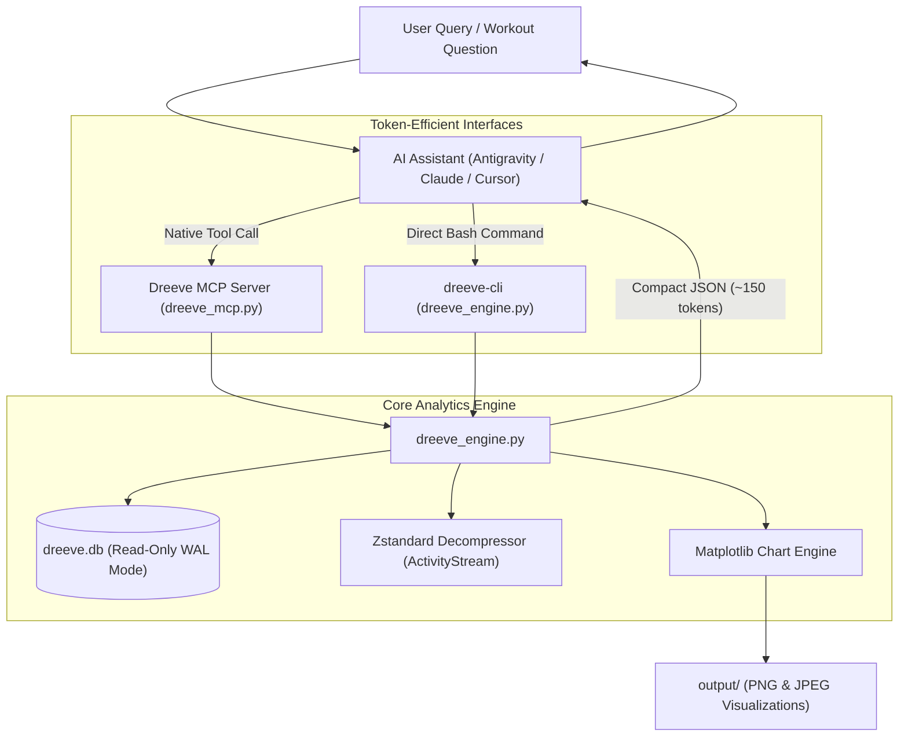

# Dreeve Running Analytics & MCP Server 🏃‍♂️📊

[](https://www.python.org/downloads/)
[](https://modelcontextprotocol.io/)
[](https://opensource.org/licenses/MIT)

A high-performance, token-efficient analytics engine and [Model Context Protocol (MCP)](https://modelcontextprotocol.io/) server built for self-hosted [Dreeve](https://github.com/robiningelbrecht/dreeve) / Runwise fitness databases.

Designed specifically to empower AI pair-programming assistants (such as Google Antigravity, Claude, and ChatGPT) with instant, direct access to running metrics and sub-second kilometer splits without burning tokens on raw SQL dumps, blind directory searches, or ad-hoc scripting.

---

## Architecture Overview



---

## Key Highlights

* **Token-Optimized Aggregation:** Queries return compact, pre-summarized JSON payloads (~150–250 tokens), preventing context window exhaustion.
* **Sub-Second Kilometer Split Analytics:** Built-in Zstandard decompression pipeline decodes high-frequency sensor streams, computing exact split pacing, mean HR, and cardiac drift in < 0.2s.
* **Instant Visualizations:** Generates publication-ready dark/light theme charts (`Pace vs. HR Scatter`, `Longitudinal Progression Dashboard`, `Kilometer Splits Analysis`) saved automatically into a dedicated [`output/`](./output) folder.
* **Dual Interface:** Use as a native MCP server or as a standalone command-line tool via `dreeve-cli`.
* **Zero Database Contention:** Connects via URI read-only mode (`?mode=ro`) with SQLite Write-Ahead Logging (WAL) support, guaranteeing zero locks on the running Dreeve instance.

---

## Directory Structure

```text
dreeve-analytics/
├── dreeve_engine.py       # Core analytics, statistics, stream decompression & plotting engine
├── dreeve_mcp.py          # Model Context Protocol stdio server
├── dreeve-cli             # System executable wrapper
├── requirements.txt       # Python dependencies
├── config/
│   └── mcp_config.example.json  # Sample MCP client configuration
├── skill/
│   └── dreeve-runner/
│       └── SKILL.md       # Global Antigravity Agent Skill definition
├── output/                # Dedicated folder for generated plots & exports
│   ├── dreeve_pace_vs_heart_rate.png
│   ├── dreeve_pace_hr_dashboard.png
│   └── october_splits_pace_vs_hr.png
└── README.md
```

---

## Sample Visualizations

All visual exports are automatically routed to the [`output/`](./output) directory:

### 1. Standalone Pace vs. Heart Rate Scatter & Zone Efficiency
Shows individual runs with point size proportional to distance, colored by activity recency, with Heart Rate zone bands (Zone 1 to Zone 4) and linear regression fit ($R^2 = 0.82$).


### 2. Longitudinal Dashboard (Scatter + 60-Day Timeline)
Combines the cardiac efficiency curve with a dual-axis timeline of pacing and heart rate progression.


### 3. Kilometer Splits Analysis (Pace vs. Mean HR per Kilometer)
Analyzes 83 individual kilometer splits across all October runs, colored by split progression (Km 1 through Km 8).


---

## Installation & Setup

### 1. Prerequisites
* Python 3.10+ (Recommended in a dedicated environment, e.g., `conda activate ml_env`)
* Access to your local `dreeve.db` SQLite database file.

### 2. Install Dependencies
```bash
git clone https://github.com/JournalKenobi/dreeve-analytics.git
cd dreeve-analytics
pip install -r requirements.txt
```

---

## CLI Usage (`dreeve-cli`)

A convenience wrapper is provided at `./dreeve-cli` (or link it to your `~/.local/bin/dreeve-cli`):

### 1. High-Level Statistical Summary
```bash
dreeve-cli summary --days 60
```

### 2. Kilometer Splits & Cardiac Drift
```bash
# Instant summary & cardiac drift progression (< 0.2s)
dreeve-cli splits --month 2026-10 --summary-only

# Detailed split log for a specific workout
dreeve-cli splits --activity <activity_id>
```

### 3. List Activities
```bash
# Recent 10 runs with heart rate telemetry
dreeve-cli activities --days 30 --limit 10 --with-hr

# Search specific workouts
dreeve-cli activities --search "HIIT"
```

### 4. Generate Performance Charts
```bash
# Standalone pace vs HR curve (saved to output/ folder)
dreeve-cli plot --type pace_vs_hr --days 60 --theme dark

# 2-Panel dashboard
dreeve-cli plot --type dashboard --days 60 --theme dark
```

---

## MCP Server Integration

Add `dreeve` to your MCP configuration file (e.g. `~/.gemini/config/mcp_config.json` for Antigravity, or `claude_desktop_config.json`):

```json
{
  "mcpServers": {
    "dreeve": {
      "command": "/home/journalkenobi/miniconda3/envs/ml_env/bin/python",
      "args": [
        "/home/journalkenobi/projects/dreeve-analytics/dreeve_mcp.py"
      ],
      "env": {
        "PYTHONPATH": "/home/journalkenobi/projects/dreeve-analytics",
        "DREEVE_DB_PATH": "/home/journalkenobi/projects/dreeve/storage/database/dreeve.db",
        "DREEVE_OUTPUT_DIR": "/home/journalkenobi/projects/dreeve-analytics/output"
      }
    }
  }
}
```

### Exposed MCP Tools

| Tool | Parameters | Description |
| :--- | :--- | :--- |
| `dreeve_summary` | `days`, `sport` | High-level metrics, zone breakdowns, and pace-HR correlation in ~150 tokens. |
| `dreeve_splits` | `activity_id`, `days`, `month`, `summary_only` | Sub-second kilometer splits, pace, mean HR, and cardiac drift progression. |
| `dreeve_activities` | `days`, `limit`, `with_hr_only`, `search` | Concise tabular list of recent workouts. |
| `dreeve_plot` | `chart_type`, `days`, `theme` | Renders and saves high-resolution charts to `output/`. |
| `dreeve_query` | `sql` | Safely executes read-only SQL queries with automatic token safeguards. |

---

## License

This project is licensed under the [MIT License](LICENSE).
