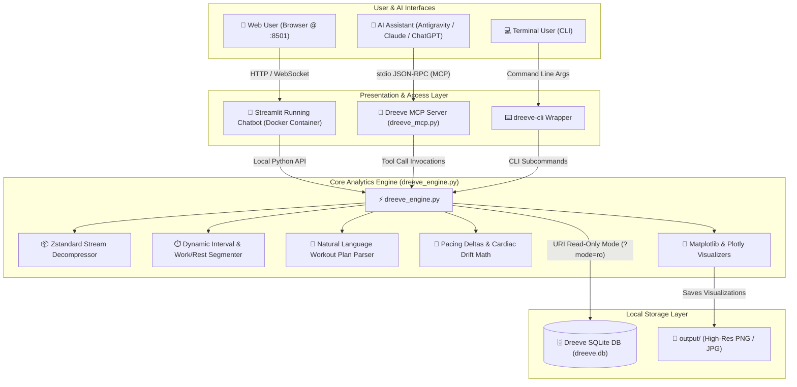
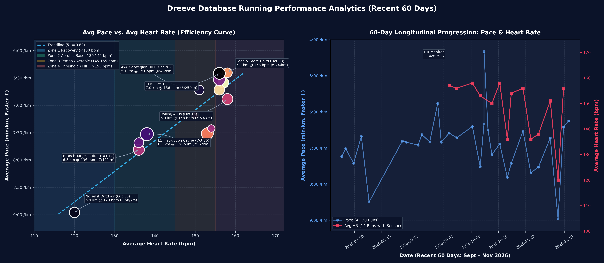
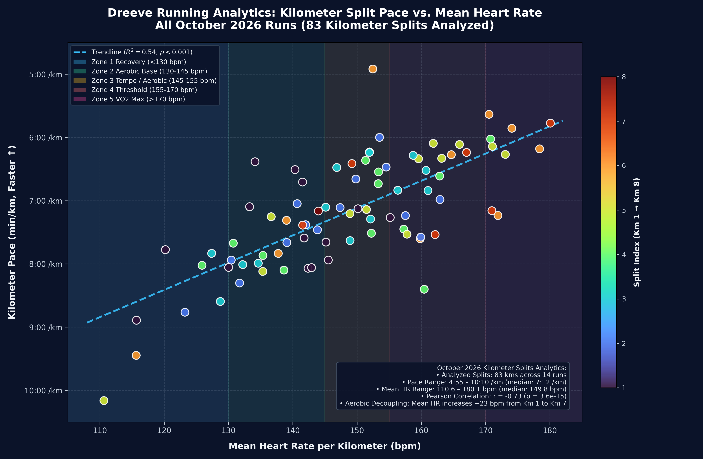

# Dreeve Running Analytics & AI Coach Suite 🏃‍♂️📊

[](https://www.python.org/downloads/)
[](https://streamlit.io/)
[](https://www.docker.com/)
[](https://modelcontextprotocol.io/)
[](https://opensource.org/licenses/MIT)

A privacy-first, zero-cloud-cost analytics engine, [Model Context Protocol (MCP)](https://modelcontextprotocol.io/) server, and interactive Dockerized web chatbot built for self-hosted [Dreeve](https://github.com/robiningelbrecht/dreeve) fitness databases.

Computes sub-second kilometer splits, decompressing high-frequency Zstandard sensor streams, analyzes arbitrary interval workouts (with natural language plan parsing or auto-detection), tracks cardiac drift, and provides an interactive self-hosted web chatbot UI alongside native AI agent tool integrations.

---

## 🏛️ System Architecture



---

## ✨ Key Capabilities

* **100% Local & Privacy-First (Zero Cloud / Token Costs):** Runs entirely on local CPU power with zero external LLM API costs or privacy leaks. All analytics, signal filtering, and data visualizations are computed in milliseconds locally.
* **Arbitrary & Variable Interval Analysis:**
  * Accepts natural language workout plans: e.g. `1k warmup + 4x1K @6:15 with 90s walk + 0.5k cooldown` or `0.8k easy, 2*1.5k @ 6:00, 1k @ 7:00`.
  * Computes work interval pacing, target pace deltas, peak HR, and heart rate recovery drop during rest breaks.
  * Robust fallback **auto-detection** for unstructured or freeform interval runs.
* **Sub-Second Stream Decompression:** Built-in Zstandard decompression decodes sub-second GPS, cadence, heart rate, and elevation telemetry from the Dreeve `ActivityStream` store.
* **Kilometer Splits & Cardiac Drift Tracking:** Aggregates splits across weeks or months to quantify cardiovascular decoupling and aerobic endurance progression.
* **Containerized Web Chatbot:** Self-hosted Streamlit container (`dreeve-running-chat`) providing an interactive running coach UI with inline telemetry charts, tables, and quick action prompts.
* **Native Model Context Protocol (MCP):** Connects directly to AI coding and research agents (Antigravity, Claude Desktop, Cursor) with token-optimized JSON summaries (~150 tokens) to prevent context exhaustion.

---

## 📁 Repository Structure

```text
dreeve-analytics/
├── app.py                     # Streamlit interactive web chatbot application
├── Dockerfile                 # Container specification for web chatbot
├── docker-compose.yml         # Compose configuration (volume mounts, homelab network)
├── dreeve_engine.py           # Core analytics, interval parsing, stream decompression & plotting
├── dreeve_mcp.py              # Model Context Protocol (MCP) server
├── dreeve-cli                 # Executable CLI wrapper
├── requirements.txt           # Python package requirements
├── config/
│   └── mcp_config.example.json # Example MCP configuration for AI agents
├── skill/
│   └── SKILL.md               # Antigravity Agent Skill instructions
└── output/                    # Persistent directory for generated plots & reports
```

---

## 🚀 Getting Started

### 1. Running the Web Chatbot with Docker (Recommended)

The easiest way to use the interactive chatbot is via Docker Compose:

```bash
# Clone the repository
git clone https://github.com/JournalKenobi/dreeve-analytics.git
cd dreeve-analytics

# Start the chatbot container
docker compose up -d
```

Open your browser at **[http://localhost:8501](http://localhost:8501)** to chat with your running coach.

#### Docker Configuration (`docker-compose.yml`)
The container mounts your local Dreeve database in read-only mode and connects to your local network:
```yaml
services:
  dreeve-running-chat:
    build: .
    container_name: dreeve-running-chat
    restart: unless-stopped
    ports:
      - "8501:8501"
    volumes:
      - /path/to/dreeve/storage/database:/data/database:ro
      - ./output:/app/output:rw
    environment:
      - DREEVE_DB_PATH=/data/database/dreeve.db
      - DREEVE_OUTPUT_DIR=/app/output
      - TZ=Asia/Kolkata
    networks:
      - homelab
```

---

### 2. Standalone CLI Usage (`dreeve-cli`)

For terminal workflows, use `./dreeve-cli`:

#### Variable Interval Workout Analysis
```bash
# Analyze with a structured plan
./dreeve-cli intervals --plan "1k warmup + 4x1k @6:15 with 90s walk + 0.5k cooldown"

# Analyze with variable distances
./dreeve-cli intervals --plan "0.8k easy, 2x1.5k @ 6:00, 1k @ 7:00"

# Auto-detect intervals without a plan
./dreeve-cli intervals --activity <activity_id>
```

#### High-Level Performance Summary
```bash
./dreeve-cli summary --days 60
```

#### Kilometer Splits & Cardiac Drift
```bash
./dreeve-cli splits --month 2026-10 --summary-only
```

#### Generate Telemetry Charts
```bash
# Pace vs. Heart Rate Scatter
./dreeve-cli plot --type pace_vs_hr --days 60 --theme dark

# Longitudinal Performance Dashboard
./dreeve-cli plot --type dashboard --days 60 --theme dark
```

---

### 3. MCP Server Integration (for AI Assistants)

Add `dreeve` to your agent's MCP configuration (`mcp_config.json`):

```json
{
  "mcpServers": {
    "dreeve": {
      "command": "python",
      "args": ["/path/to/dreeve-analytics/dreeve_mcp.py"],
      "env": {
        "PYTHONPATH": "/path/to/dreeve-analytics",
        "DREEVE_DB_PATH": "/path/to/dreeve/storage/database/dreeve.db",
        "DREEVE_OUTPUT_DIR": "/path/to/dreeve-analytics/output"
      }
    }
  }
}
```

#### Available MCP Tools

| Tool | Parameters | Description |
| :--- | :--- | :--- |
| `dreeve_intervals` | `activity_id`, `plan`, `generate_plot` | Analyzes variable structured interval runs or auto-detects work/rest reps with HR recovery drops. |
| `dreeve_summary` | `days`, `sport` | Statistical summary, HR zones, and pacing correlation in ~150 tokens. |
| `dreeve_splits` | `activity_id`, `days`, `month`, `summary_only` | Sub-second kilometer splits, pacing, mean HR, and cardiac drift progression. |
| `dreeve_activities` | `days`, `limit`, `with_hr_only`, `search` | Filtered list of recent workout activities. |
| `dreeve_plot` | `chart_type`, `days`, `theme` | Renders high-resolution fitness plots directly into `output/`. |
| `dreeve_query` | `sql` | Safe, read-only SQL query execution with automatic row/token guardrails. |

---

## 📊 Sample Visualizations

All visual telemetry exports are stored in [`output/`](./output):

### 1. Interval Session Breakdown
Renders continuous pace, heart rate, cadence, and elevation telemetry curves overlaid with work (blue) vs. walk recovery (orange) blocks and calculated HR drop metrics.


### 2. Longitudinal Dashboard (Aerobic Efficiency + Progression)
Combines aerobic efficiency curves with 60-day pace and heart rate progression.



### 3. Kilometer Splits & Cardiac Decoupling
Visualizes pace vs. mean HR across 80+ kilometer splits to observe cardiovascular drift.



---

## 🔒 Security & Concurrency

- **Read-Only Database Connection**: The engine and Docker container connect to SQLite using `file:...??mode=ro` with SQLite WAL mode. It can never corrupt or lock the running Dreeve database.
- **Isolated Sandbox**: The Docker container runs with unprivileged execution, restricted file mounts, and read-only database access.

---

## 📄 License

This project is licensed under the [MIT License](LICENSE).
