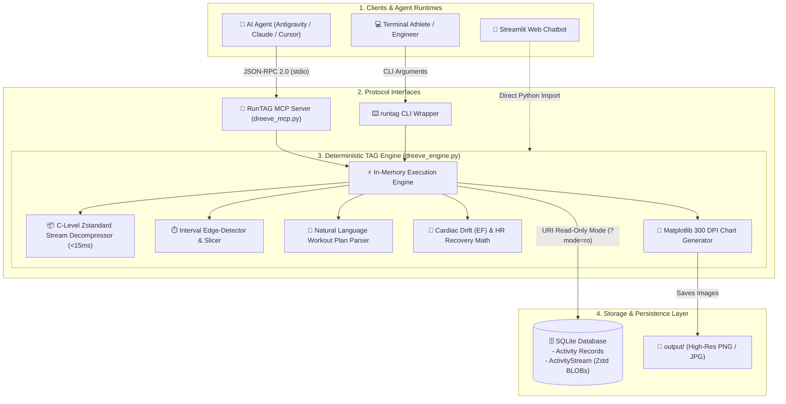

# RunTAG: Tool-Augmented Generation & MCP Server for Running Telemetry 🏃‍♂️⚡

[](https://www.python.org/downloads/)
[-purple.svg)](#-why-tag-tool-augmented-generation-over-rag)
[-emerald.svg)](https://modelcontextprotocol.io/)
[](https://facebook.github.io/zstd/)
[](https://opensource.org/licenses/MIT)

**RunTAG** is a high-performance **Tool-Augmented Generation (TAG)** engine and **Model Context Protocol (MCP)** server engineered for athletic running telemetry.

Instead of stuffing massive, noisy sensor logs into an LLM context window or relying on vector search (RAG) that hallucinates mathematical calculations, **RunTAG** equips AI agents and terminal users with **deterministic tool execution directly against SQLite time-series stores**:
* **Sub-15ms Decompression**: Decodes second-by-second Zstandard (`zstd`) binary streams in RAM.
* **Natural Language Interval Parsing**: Slices continuous GPS and PPG streams using workout plans (e.g. `"1k warmup + 4x1K @6:15 with 90s walk + 0.5k cooldown"`).
* **Deterministic Biometrics**: Calculates Heart Rate Recovery Drop ($\Delta\text{HR}$), Joe Friel's Aerobic Decoupling / Cardiac Drift ($EF$), and pace-to-HR Pearson correlation ($r, R^2$).
* **99.8% Token Reduction**: Compresses 3–5 MB (~60,000 tokens) of raw GPS/HR streams into an ultra-dense **~180-token JSON summary**.

---

## 🧠 Why TAG (Tool-Augmented Generation) Over RAG?

| Metric / Feature | Traditional Vector RAG | RunTAG (Tool-Augmented Generation) |
| :--- | :--- | :--- |
| **Data Nature** | Unstructured text documents | High-frequency continuous time-series (1 Hz sensor streams) |
| **Retrieval Method** | Chunking & Cosine similarity embeddings | Deterministic SQLite WAL queries + in-memory C decompression |
| **Mathematical Accuracy** | ❌ **High Hallucination Risk** (LLMs cannot reliably calculate statistical regressions over 28,000 floats) | ✅ **100% Deterministic** (Exact C / NumPy array math) |
| **Token Overhead** | 50,000 – 100,000 tokens per workout log | **~150 – 250 tokens** total per analytical response |
| **Execution Latency** | 10 – 25 seconds (embedding search + massive prompt) | **< 20 milliseconds** end-to-end |
| **Database Contention** | High (frequent vector re-indexing) | Zero (Direct SQLite URI read-only mode `?mode=ro` with WAL) |

---

## 🏛️ System Architecture



---

## ✨ Key Capabilities

1. **Sub-Second Stream Decompression**:
   * Telemetry is stored as raw Zstandard compressed BLOBs inside SQLite. RunTAG decompresses `time`, `distance`, `heartrate`, `cadence`, `altitude`, and `latlng` directly into contiguous NumPy arrays in under 15 milliseconds.
2. **Variable Interval & Repetition Analysis**:
   * Accepts natural language workout plans:
     * Structured: `1k warmup + 4x1K @6:15 with 90s walk + 0.5k cooldown`
     * Variable: `0.8k easy, 2x1.5k @ 6:00, 1k @ 7:00`
   * Computes work interval pacing, target pace deltas, peak HR, and heart rate recovery drop during rest breaks.
   * Robust fallback **auto-detection** for unstructured tempo or freeform fartleks.
3. **Cardiovascular Decoupling & Cardiac Drift**:
   * Divides steady runs into two equal halves.
   * Calculates Efficiency Factor ($EF = \frac{\text{Normalized Speed}}{\text{Heart Rate}}$) for Half 1 vs. Half 2.
   * Evaluates against Joe Friel's 5% threshold ($<5\%$ indicates strong aerobic base; $>5\%$ indicates fatigue or cardiac drift).
4. **Native Model Context Protocol (MCP)**:
   * Communicates over standard I/O (`transport="stdio"`), allowing AI coding and research agents to query running history without token waste.
5. **Zero Database Contention**:
   * Connects via SQLite URI read-only mode (`?mode=ro`) with Write-Ahead Logging (WAL), guaranteeing zero locks on running servers.

---

## 📁 Repository Structure

```text
RunTAG/
├── dreeve_engine.py           # Core computational engine: Zstd decompression, interval math, plotting
├── dreeve_mcp.py              # Model Context Protocol (MCP) server implementation
├── runtag                     # Primary executable CLI wrapper
├── dreeve-cli                 # Backward-compatible CLI alias
├── requirements.txt           # Python package dependencies
├── .env.example               # Environment configuration template
├── config/
│   └── mcp_config.example.json # Example MCP configuration for AI agents
├── skill/
│   └── SKILL.md               # Antigravity Agent Skill definitions
├── LEARN.md                   # In-depth architectural & physiological mental models
└── output/                    # Persistent directory for generated plots & reports
```

---

## 🚀 Getting Started

### 1. Installation

```bash
git clone https://github.com/JournalKenobi11/RunTAG.git
cd RunTAG
pip install -r requirements.txt
```

### 2. Configuration

Copy the environment template and point to your SQLite database (`dreeve.db` or `running.db`):

```bash
cp .env.example .env
```

Edit `.env`:
```ini
# Path to your Dreeve / Runwise SQLite database
DREEVE_DB_PATH=../dreeve/storage/database/dreeve.db

# Output directory for generated plots and reports
DREEVE_OUTPUT_DIR=./output
```

---

## ⌨️ CLI Usage (`./runtag`)

RunTAG includes an executable command-line interface for human power users:

### Structured & Variable Interval Workout Analysis
```bash
# Analyze structured repeats with target pace and rest duration
./runtag intervals --plan "1k warmup + 4x1k @6:15 with 90s walk + 0.5k cooldown"

# Analyze variable distance repeats
./runtag intervals --plan "0.8k easy, 2x1.5k @ 6:00, 1k @ 7:00"

# Auto-detect intervals without a plan
./runtag intervals --activity <activity_id>
```

### Performance Summary & Training Zones
```bash
./runtag summary --days 60
```
*Returns total distance, active duration, average pace, HR zone breakdown, and pace-HR correlation.*

### Kilometer Splits & Cardiac Drift
```bash
./runtag splits --month 2026-10 --summary-only
```

### Publication-Ready Chart Generation
```bash
# Pace vs. Heart Rate Scatter
./runtag plot --type pace_vs_hr --days 60 --theme dark

# 2-Panel Longitudinal Performance Dashboard
./runtag plot --type dashboard --days 60 --theme dark
```
*Generated plots are saved directly to `output/`.*

---

## 🔌 Model Context Protocol (MCP) Integration

Connect **RunTAG** directly to AI agents (Google Antigravity, Claude Desktop, Cursor) by adding it to your agent's MCP configuration (`mcp_config.json`):

```json
{
  "mcpServers": {
    "runtag": {
      "command": "python3",
      "args": ["/path/to/RunTAG/dreeve_mcp.py"],
      "env": {
        "PYTHONPATH": "/path/to/RunTAG",
        "DREEVE_DB_PATH": "/path/to/dreeve/storage/database/dreeve.db",
        "DREEVE_OUTPUT_DIR": "/path/to/RunTAG/output"
      }
    }
  }
}
```

### Exposed MCP Tools

| Tool | Key Arguments | Description | Output Size |
| :--- | :--- | :--- | :--- |
| **`dreeve_intervals`** | `activity_id`, `plan`, `generate_plot` | Segments workout repeats, work vs. rest ratios, pace deltas, and recovery HR drops. | ~250 tokens |
| **`dreeve_summary`** | `days`, `sport` | Mileage, average pace, HR zones, and pace-to-HR correlation ($R^2$). | ~150 tokens |
| **`dreeve_splits`** | `activity_id`, `month`, `summary_only` | Sub-second kilometer splits, pacing progression, and aerobic decoupling. | ~100 tokens |
| **`dreeve_activities`**| `days`, `limit`, `with_hr_only` | Filtered list of recent workout activities. | ~150 tokens |
| **`dreeve_plot`** | `chart_type`, `days`, `theme` | Renders high-resolution 300 DPI fitness plots to disk. | ~80 tokens |
| **`dreeve_query`** | `sql` | Safe, read-only SQL query gateway with automatic row/token guardrails. | Dynamic |

---

## 🌐 The Aerolap Ecosystem

* **[Aerolap](https://github.com/JournalKenobi11/Aerolap)**: The full self-hosted sports analytics web platform and database server.
* **[Running-analytics-chatbot](https://github.com/JournalKenobi11/Running-analytics-chatbot)**: Interactive Streamlit web chat UI powered by the RunTAG engine.
* **[RunTAG](https://github.com/JournalKenobi11/RunTAG)**: The core Tool-Augmented Generation (TAG) engine, CLI, and MCP server.

---

## 📄 License

This project is licensed under the [MIT License](LICENSE).
